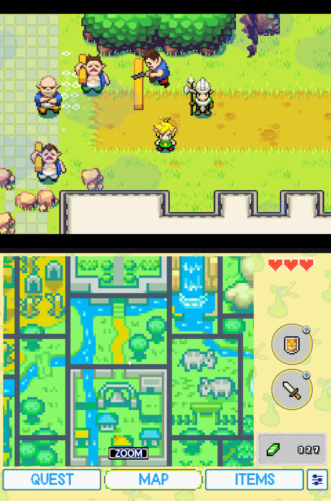

# bananaOS / Anbernic RG DS



Project Picori runs natively on the Anbernic RG DS under **bananaOS** (aarch64 Linux, two 1024x768 panels).
The game is on the top panel (DSI-2) and the second screen of this fork (map, dungeon map, quest, items,
settings) is on the bottom panel (DSI-1), with touch.

This is the same second-screen compositor as the Android build (`port/port_second_screen.c`). Only the
output differs: instead of an Android `Presentation`, `port/port_banana_panel.inc` takes the DRM device SDL
already opened, drives the bottom connector with a dumb buffer from its own thread (~12 Hz, low priority) and
reads the touch panel straight from evdev.

## Install

(The launcher script is also kept in `bananaos/`.)

1. Unzip the release into your ports folder (`/roms/ports`). You get `The Minish Cap - 2 Screens.sh` and the
   folder `tmc/`.
2. Put your own ROM (USA, SHA-1 `b4bd50e4131b027c334547b4524e2dbbd4227130`) at
   `/roms/gba/Legend of Zelda, The - The Minish Cap (USA).gba`. The launcher copies it to `tmc/baserom.gba`.
3. Start **The Minish Cap - 2 Screens** from the ports list. The first start extracts the assets from the ROM
   (about 100 seconds), later starts are immediate.

No game data is included in the release.

## Controls

- Gamepad as in the desktop build. **Select + Start exits the game** (there is no window to close).
- Touch on the bottom panel: the same taps as on Android.

## Environment variables (set by the launcher)

| Variable | Use |
| --- | --- |
| `SDL_VIDEODRIVER=kmsdrm` | video through DRM/KMS |
| `SDL_VIDEO_DISPLAY_PRIORITY=DSI-2` | game on the top panel (stock SDL3 has no `SDL_KMSDRM_FIRST`) |
| `BANANA_PANEL=1` | enable the bottom panel |
| `BANANA_PANEL_ID` | DSI connector number of the bottom panel (default 1) |
| `BANANA_TOUCH` | touch device path (default: the Goodix evdev device) |
| `BANANA_TOUCH_SWAP`, `BANANA_TOUCH_FLIPX`, `BANANA_TOUCH_FLIPY` | touch axis corrections |
| `SDL_AUDIODRIVER=alsa` | sound through ALSA (`/etc/asound.conf` routes it to the speakers) |
| `SDL_AUDIO_DEVICE_SAMPLE_FRAMES=2048` | larger audio buffer, avoids underruns |

`touch /tmp/banana-shot` while the game runs writes `/tmp/banana-top.png` and `/tmp/banana-bottom.ppm`.

## Build (cross-compile on x86_64)

Tested in a Debian trixie chroot with `gcc-aarch64-linux-gnu`, arm64 multiarch `libdrm-dev`, `libasound2-dev`,
`libpng-dev`, `libgles-dev`, `libegl-dev`, and xmake 2.9.9.

```sh
export PKG_CONFIG_LIBDIR=/usr/lib/aarch64-linux-gnu/pkgconfig:/usr/share/pkgconfig
xmake f -c -y --policies=package.precompiled:n -p linux -a arm64 --cross=aarch64-linux-gnu- \
    --game_version=USA --gpu_renderer=n --banana_panel=y --multi_region=y --widescreen_width=384
xmake build -y tmc_pc
```

`--policies=package.precompiled:n` is required: xmake otherwise downloads a prebuilt SDL3 without KMSDRM.
SDL3 is built statically with KMSDRM and ALSA and without X11/Wayland. The xmake-repo `libsdl3` package needs
these CMake options for a cross build (apply to your local xmake-repo copy):

```
-DSDL_UNIX_CONSOLE_BUILD=ON -DSDL_KMSDRM=ON -DSDL_KMSDRM_SHARED=ON
-DSDL_ALSA=ON -DSDL_ALSA_SHARED=OFF
-DALSA_INCLUDE_DIR=/usr/include -DALSA_LIBRARY=/usr/lib/aarch64-linux-gnu/libasound.so
```

and `asound` added to the package's Linux `syslinks`.

## Other changes made for this target

- The second-screen state (`port_second_screen_state.c`) is published on this target too, not only on Android.
- `Port_IsLoadedAssetBytes` / `Port_LoadedAssetBytesEnd` use a sorted address index instead of walking every
  cached asset blob on each call. That walk made entering rooms stutter (~60 ms frames) once many areas were
  loaded; it helps every platform.
- Select + Start exits instead of opening the F8 menu.

Tested on bananaOS 0.5.0.1, Anbernic RG DS Plus. Not tested: other versions or devices.
